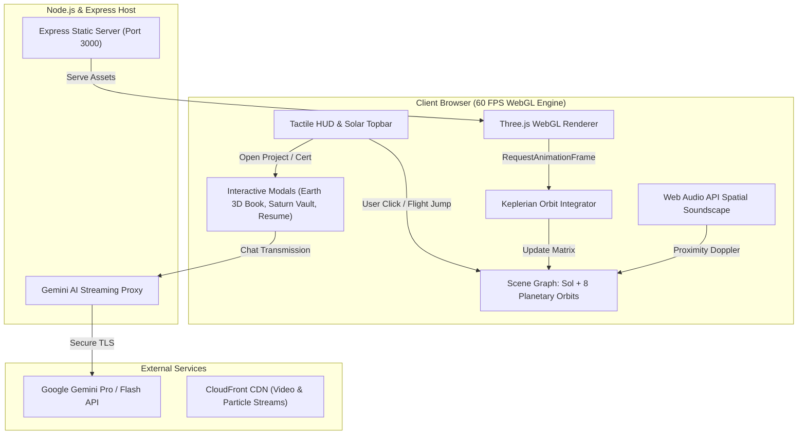

#   Portfolio Page

<div align="center">

[](http://localhost:3000)
[](https://github.com/TanishkaSahu191)
[](LICENSE)
[](#)
[](#)

<br/>

**A next-generation, high-performance 3D celestial portfolio crafted with pure Three.js, custom GLSL atmospheric shaders, spatial Web Audio, and an in-universe Gemini AI assistant (Nova AI).**

[Explore Planets](#-celestial-destinations-interactive-directory) • [Architecture](#-system-architecture) • [Projects](#-software-projects-archive) • [Controls](#-interactive-flight-controls) • [Quick Start](#-quick-start--local-deployment)

</div>

---

##  Interactive Overview

 Reimagines the my portfolio as an **interactive planetary exploration vessel**.
 Visitors navigate across the solar system where each celestial body represents a foundational pillar of engineering, scholarship, and creative development.

```
                   ☀️ SOL [Nova AI Assistant]
                     │
    ┌───────────┬────┴───────┬─────────────┬───────────┐
    ☿           ♀            ♁             ♂           ♃
 MERCURY      VENUS        EARTH         MARS       JUPITER
Cosmic ID   Philosophy  3D Project Book Education  Achievements
                           │
             ┌─────────────┴─────────────┐
             ♄                           ♅            ♆
           SATURN                      URANUS       NEPTUNE
     Certifications & Vault         3D Laptop Resume Contacts
```

---

##  Celestial Destinations (Interactive Directory)

Click on any celestial body below to expand its mission specs, engineering telemetry, and in-universe features:

<details open>
<summary><b> SOL // Ask Nova AI (In-Universe Gemini Intelligence)</b></summary>
<br/>

* **Role**: Primary Solar Core & Conversational AI Copilot.
* **Technology**: Google Gemini Interactions API, WebSockets / Express streaming proxy, context-grounded portfolio archives.
* **Features**:
  * Real-time conversational AI answering queries on Tanishka's tech stack, academics, and projects.
  * In-universe astronaut transmission audio feedback with procedural HUD status.
  * Dynamic prompt grounding preventing hallucinations regarding contact info or achievements.

</details>

<details>
<summary><b>☿ MERCURY // Cosmic Developer ID & Core Stack</b></summary>
<br/>

* **Role**: Innermost orbital telemetry & cryptographic developer badge.
* **Technology**: CSS 3D matrix transform, glassmorphism, dynamic holographic tilt glare.
* **Features**:
  * Verified developer identity card for **Tanishka Sahu**.
  * Core competencies: Data Structures & Algorithms, React 19, TypeScript, Three.js, Node.js, Express, MongoDB.
  * Active student status at Vellore Institute of Technology (VIT Bhopal), CGPA 9.52.

</details>

<details>
<summary><b>♀ VENUS // Meet Tanishka Sahu (Biography & Engineering Vision)</b></summary>
<br/>

* **Role**: Atmospheric narrative module & personal engineering philosophy.
* **Technology**: High-density typography hierarchy, tactile card layout, procedural glowing corona.
* **Features**:
  * In-depth journey from foundational programming to full-stack spatial engineering.
  * Problem-solving philosophy centered on performant real-world utility and clean software architecture.

</details>

<details>
<summary><b>♁ EARTH // 3D Project Book (Software Chronicles)</b></summary>
<br/>

* **Role**: Interactive 3D flippable parchment chronicles featuring 5 flagship software projects.
* **Technology**: Pure CSS 3D multi-axis page turn dynamics (`preserve-3d`), dynamic paper lighting, traveling cast shadow.
* **Featured Projects**:
  1. **ParkShark**: Smart Bicycle Management & 3D Campus Explorer (Three.js, React 19, Firebase, TypeScript).
  2. **PiggyPocket**: Student Budget & Adaptive Daily Allowance Engine (59 Vitest test suites, OAuth 2.0).
  3. **HackFest**: Full-Stack Collegiate Hackathon Management Platform (React 19, Express, MongoDB).
  4. **Swasthyam**: Community Maternal & Pediatric AI Companion (Johns Hopkins Hackathon Winner, RAG).
  5. **Lumora**: Interactive 3D Celestial Solar System Engine (Three.js, GLSL, Web Audio, Gemini AI).

</details>

<details>
<summary><b>♂ MARS // Education Timeline (Academic Trajectory)</b></summary>
<br/>

* **Role**: Chronological academic journey across foundational schooling and engineering degree.
* **Technology**: Cinematic Martian video background backdrop with dynamic parallax overlay.
* **Trajectory**:
  * **Class 10th**: Satluj Public School, Haryana — **97%** (CBSE Science & Mathematics).
  * **Class 12th**: Stepping Stones Senior Secondary School, Chandigarh — **90%** (CBSE PCM Non-Medical).
  * **B.Tech CSE**: Vellore Institute of Technology (VIT Bhopal) — **Current CGPA: 9.52** (2025–2029).

</details>

<details>
<summary><b>♃ JUPITER // Galactic Achievements Belt</b></summary>
<br/>

* **Role**: Massive planetary gravity well archiving competitive hackathons and honors.
* **Highlights**:
  * **Johns Hopkins University × VIT Bhopal Hackathon**: Healthcare Innovation Distinction for Swasthyam.
  *  **Collegiate DSA League**: 6th Position Solo Contender (Graphs, Trees, Dynamic Programming).
  *  **SpellQuest India State Championship**: 1st Position State Winner (Club V).

</details>

<details>
<summary><b>♄ SATURN // Hanging Credentials & Certifications Vault</b></summary>
<br/>

* **Role**: Suspended glass vault featuring verified credentials hanging from metallic rings.
* **Technology**: Kinetic pendulum swing physics on mouse hover, modal lightbox certificate inspector.
* **Credentials**:
  * **NPTEL • IIT Kanpur**: Elite + Top 5% Topper (88%) in Marketing Management.
  * **WhiteHat Jr**: Certified Game Developer (Interactive Game Physics & Algorithms).
  * **SpellQuest India**: State Level Gold Winner Certificate.
  * **Collegiate DSA League**: Verified 6th Position Contender Credential.

</details>

<details>
<summary><b>♅ URANUS // 3D Laptop Workspace & Interactive Resume</b></summary>
<br/>

* **Role**: Tactile 3D workspace showcasing an interactive modular resume card and PDF telemetry.
* **Technology**: Modular card UI, clean typography, direct PDF download trigger, squircle TS avatar.
* **Sections**:
  * Metrics: 12+ Technologies, 9.52 Current CGPA, Core Member at Data Science Club VIT Bhopal.
  * One-click download of official `tanishka-sahu-resume.pdf`.

</details>

<details>
<summary><b>♆ NEPTUNE // Mission Telemetry & Contact Coordinates</b></summary>
<br/>

* **Role**: Deep-space communications terminal.
* **Channels**:
  * **GitHub**: [@TanishkaSahu191](https://github.com/TanishkaSahu191)
  * **LinkedIn**: [Tanishka Sahu](https://www.linkedin.com/in/tanishka-sahu-7b1b3628b/)
  * **Direct Email**: [tanishkasahuwork191@gmail.com](mailto:tanishkasahuwork191@gmail.com)

</details>

---

##  System Architecture



---

##  Tech Stack Matrix

| Layer | Technologies |
|---|---|
| **3D & Graphics Engine** | Three.js (r128), WebGL, Custom GLSL Shaders, Canvas 2D Minimap |
| **Frontend Architecture** | HTML5 Semantic Architecture, Modern CSS3 3D Preserves, Vanilla ES6+ |
| **Artificial Intelligence** | Google Gemini API, Context Grounding Engine, WebSocket Streams |
| **Backend & Routing** | Node.js, Express.js, REST APIs, Dotenv Configuration |
| **Audio Synthesis** | Web Audio API (Synthesized Proximity Waves, Cockpit SFX) |
| **Testing & Quality** | Vitest, Supertest, Cross-browser Chromium/WebKit/Gecko testing |

---

##  Flagship Software Projects

| Project | Tech Stack | Key Architectural Achievement | Links |
|---|---|---|---|
| **ParkShark** | `Three.js` `React 19` `Firebase` `TypeScript` | 3D procedural campus twin with 150 live slots & single draw-call GPU instancing | [Repo](https://github.com/TanishkaSahu191/ParkShark) • [Docs](https://github.com/TanishkaSahu191/ParkShark#readme) |
| **PiggyPocket** | `React 18` `Node.js` `Express` `OAuth` | Adaptive allowance engine backed by 59 automated Vitest test suites | [Repo](https://github.com/TanishkaSahu191/PiggyPocket) • [Docs](https://github.com/TanishkaSahu191/PiggyPocket#readme) |
| **HackFest** | `React 19` `Node.js` `MongoDB` `Vite` | Multi-track hackathon portal with live rubric judging & team formation | [Repo](https://github.com/TanishkaSahu191/hackathon-website) • [Docs](https://github.com/TanishkaSahu191/hackathon-website#readme) |
| **Swasthyam** | `AI RAG` `Python` `React` `Health NLP` | Johns Hopkins Award-Winning maternal health companion with WHO vaccine tracker | [Repo](https://github.com/TanishkaSahu191/Swasthyam-1) • [Docs](https://github.com/TanishkaSahu191/Swasthyam-1#readme) |
| **Lumora Engine** | `Three.js` `GLSL` `Gemini AI` `Web Audio` | Real-time 60 FPS celestial simulation with Keplerian mechanics & conversational AI | [Live App](http://localhost:3000) • [Repo](https://github.com/TanishkaSahu191) |

---

##  Interactive Flight Controls

| Control | Action | Scope |
|---|---|---|
| **Left Click + Drag** | Orbit Camera | Freely rotate around the active celestial focus |
| **Scroll Wheel / Pinch** | Zoom Telemetry | Move camera closer or further from planetary body |
| **Right Click + Drag** | Pan Camera | Lateral translation across the galactic ecliptic plane |
| **Click on Planet / Label** | Cinematic Jump | Smooth spherical lerp flight transition directly to target |
| **Bottom Dock Buttons** | Quick Warp | Instant waypoint lock to any of the 9 celestial bodies |
| **Mission Guide Button** | Skeuomorphic Manual | Tactile system manual with auto-brightness, pillow buttons & notes |
| **Escape Key / Close Button**| Disengage Orbit | Return to wide solar system tactical perspective |

---

##  Quick Start & Local Deployment

### Prerequisites
* [Node.js](https://nodejs.org/) (v16.0 or higher recommended)
* `npm` or `yarn`

### 1. Clone the Repository
```bash
git clone https://github.com/TanishkaSahu191/lumora.git
cd lumora
```

### 2. Install Dependencies
```bash
npm install
```

### 3. Configure Environment Variables
Copy `.env.example` to `.env` and provide your Gemini API key (optional for local mock testing):
```bash
cp .env.example .env
```
Inside `.env`:
```env
GEMINI_API_KEY=your_gemini_api_key_here
PORT=3000
```

### 4. Launch Cosmic Vessel
```bash
npm start
```
Open [http://localhost:3000](http://localhost:3000) in any modern WebGL-supported browser (Chrome, Edge, Firefox, Brave, Safari).

---

##  Academic & Verification Credentials

```
┌──────────────────────────────────────────────────────────────┐
│  CANDIDATE: TANISHKA SAHU                                    │
│  INSTITUTION: VELLORE INSTITUTE OF TECHNOLOGY (VIT BHOPAL)   │
│  DEGREE: B.TECH COMPUTER SCIENCE & ENGINEERING               │
│  CURRENT CGPA: 9.52 / 10.00                                  │
│  ACCREDITATIONS: NPTEL IIT KANPUR ELITE TOPPER (TOP 5%)      │
└──────────────────────────────────────────────────────────────┘
```

---

<div align="center">

**Developed by [Tanishka Sahu](https://github.com/TanishkaSahu191)**  
*Continuous Learning • Creative Engineering

</div>
